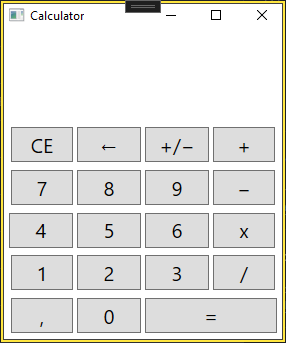
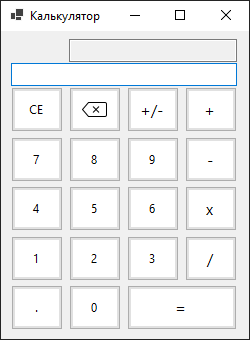

# Calculator (WPF/WinForms)

This is a project with calculator implementation on WPF/WinForms. The "Calculator.Domain" project has been tested with unit tests (TestProjectCalculator) using various arithmetic operations.

- Calculator.Domain - Core with calculation logic;
- Calculator - WinForms interface;
- Calculator.WPF - WPF interface (with MVVM);
- TestProjectCalculator - Unit tests for Domain project.

## WPF 

## WinForms 

This project was initially made using (.NET 9.0):
- Microsoft.CodeAnalysis.Analyzers (3.11.0);
- Test: XUnit (2.9.3) + Test.SDK + coverlet;
- WPF:
   * CommunityToolkit.Mvvm (8.4.0);
   * ReactiveUI (20.1.63);
   * Xaml.Behaviors.Wpf.
